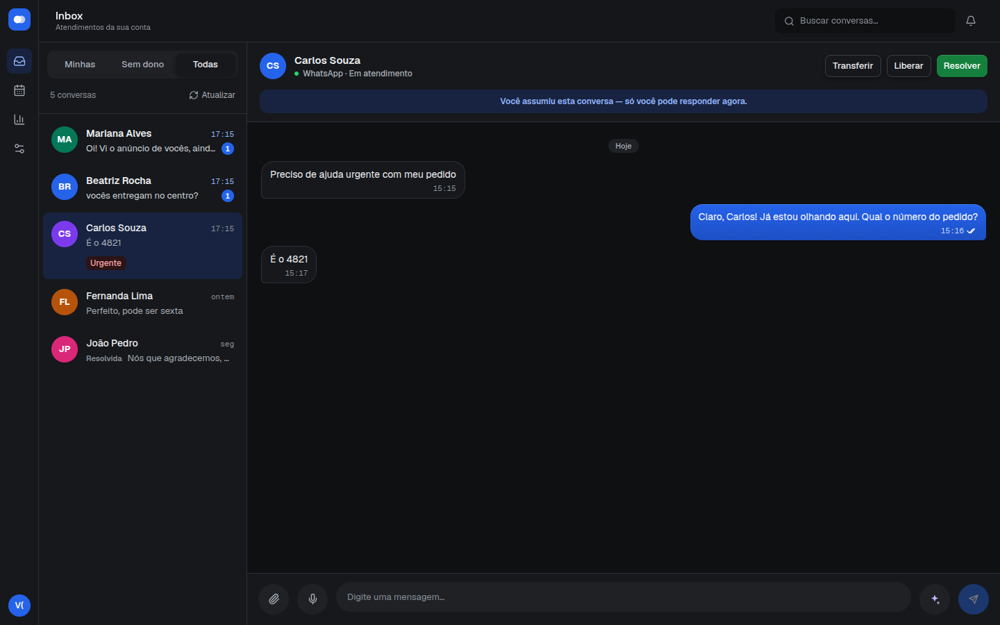
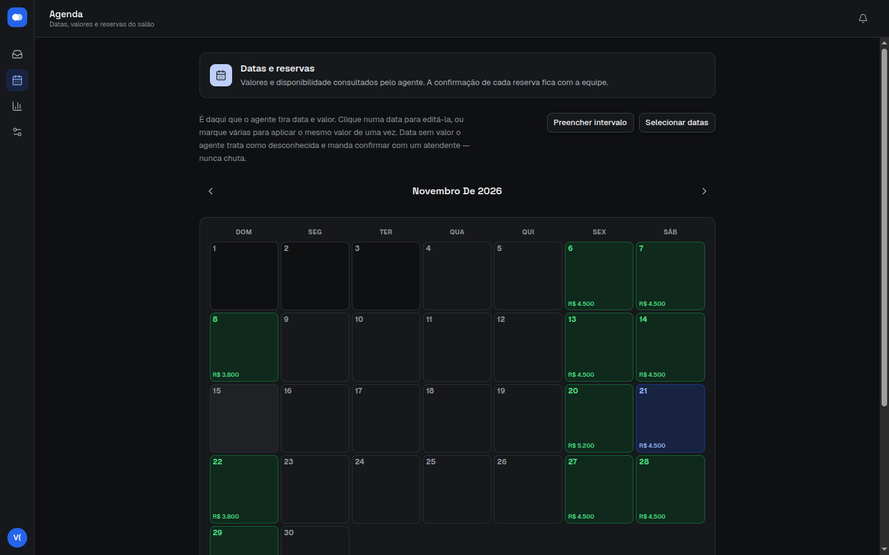
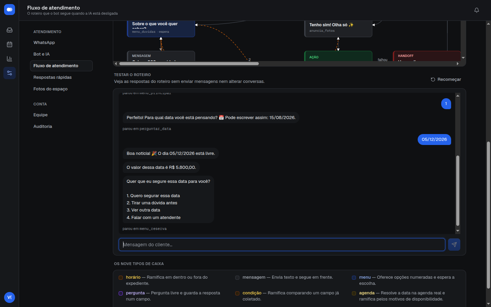

# Otto

Inbox de WhatsApp multiatendente com agente de IA e roteiro sem LLM, aplicado a salões de festas.

[](https://github.com/thisdev-davi/otto-salao-de-festas/actions/workflows/ci.yml)


Pequenos negócios atendem pelo WhatsApp com duas ou três pessoas no mesmo número. Nesse cenário, conversas se perdem, dois atendentes respondem o mesmo cliente e o preço que o bot passa não bate com a agenda. O Otto põe a equipe numa inbox compartilhada e coloca na frente um atendimento automático que **nunca inventa preço**: valor e disponibilidade saem de uma agenda transacional, o bot só **segura** uma data, e quem confirma a reserva é sempre um humano.

O atendimento automático tem dois "cérebros" que você troca no painel. O **agente de IA** conversa livremente, com persona, RAG e memória do cliente. O **roteiro** é determinístico, segue um fluxo desenhado em JSON e tem custo zero por conversa. Os dois entregam o mesmo contrato de decisão e passam pelo mesmo código de envio, encaminhamento e persistência.



## Como funciona

| Etapa | O que acontece | Onde |
|---|---|---|
| 1. Entrada | O webhook do WhatsApp chega com um segredo **por conexão** na URL; é ele que decide o tenant, nunca o corpo | `api/webhooks.py`, `services/channels.py` |
| 2. Ingestão | A mensagem é gravada de forma idempotente e sai do request para o Celery | `services/ingestion.py`, `tasks/` |
| 3. Decisão | Agente de IA **ou** roteiro, conforme o modo do tenant, devolvendo a mesma estrutura | `ai/llm.py`, `flow/engine.py` |
| 4. Agenda | Preço e disponibilidade vêm de `salao_agenda.resolver`, a única fonte de verdade | `services/salao_agenda.py` |
| 5. Ação | O bot pode segurar uma data por 48 h (pré-reserva atômica) ou mandar a galeria | `services/salao_acoes.py` |
| 6. Equipe | Handoff para a fila, captura por um atendente, aviso em tempo real por WebSocket | `services/assignment.py`, `api/ws.py` |
| 7. Confirmação | Um humano confirma a reserva e, se quiser, avisa o cliente pelo WhatsApp | `services/salao_aviso.py` |

```text
WhatsApp → adapter de canal → FastAPI → PostgreSQL ← Next.js (API + WebSocket)
                                 ↓
                          Redis / Celery
                                 ↓
                 roteiro determinístico  |  agente de IA
                                 ↓
                 agenda (preço/data) · pré-reserva · handoff
                                 ↓
                         adapter → WhatsApp
```

<table>
  <tr>
    <td></td>
    <td></td>
  </tr>
  <tr>
    <td align="center">Agenda: preço por data, bloqueios e reservas</td>
    <td align="center">Simulador do roteiro: preço lido da agenda real, sem escrever nada</td>
  </tr>
</table>

## Decisões de engenharia

As regras abaixo estão no [`CLAUDE.md`](CLAUDE.md) como invariantes do projeto, cada uma com o bug que ela previne.

- **Concorrência resolvida no banco, não em Python.** Capturar uma conversa é um `UPDATE ... WHERE assigned_user_id IS NULL`. Segurar uma data é um `INSERT ... ON CONFLICT DO NOTHING` contra um índice único **parcial** (`status IN ('pre_reservada','confirmada')`), o que libera a data de reservas canceladas sem apagar o histórico. Os dois têm teste de corrida com `asyncio.gather`.
- **O roteiro avança por transição disputada.** Não existe debounce: cada mensagem dispara um turno. O nó atual só avança com `UPDATE ... WHERE turno = :lido`, e quem perde a corrida não envia nada. Assim o cliente nunca recebe o menu duas vezes.
- **Uma implementação só da disponibilidade.** O front lê `motivo`/`livre` prontos do backend e nunca deduz "livre" a partir do preço. Uma segunda implementação da regra, quando diverge, aparece como preço errado dito ao cliente.
- **Adapter de canal isolado.** O código da Evolution API (WhatsApp não oficial, sujeito a ban) mora só em `channels/whatsapp.py`. Trocar de provider é trocar uma classe na factory.
- **Multi-tenant por linha, com defesa em profundidade.** `tenant_id` entra em toda query, e o tenant de um evento externo vem de um segredo comparado com `hmac.compare_digest`.
- **Mídia não confiável.** O `Content-Type` servido passa por uma allow-list, a URL de mídia é assinada e de curta duração (sem JWT na query), e o download de avatar só aceita HTTPS para IP público, como proteção contra SSRF.
- **Sem agendador.** Pré-reserva vencida e conversa inativa são resolvidas de forma preguiçosa, na leitura. O projeto não tem `celery beat` de propósito.
- **Auditoria transacional.** Toda alteração em tabela com `tenant_id` registra ator, ação e resultado por trigger, na mesma transação, sem copiar conversa nem segredo.

## Avaliação do agente

Teste de unidade não prova que um LLM respeita a agenda. Para isso existe `evals/`: um conjunto de conversas fixas, rodado contra um modelo real e conferido por checagens determinísticas. As checagens cobrem quatro garantias:

- valor citado sempre presente na agenda;
- nenhuma confirmação de reserva;
- pré-reserva só para data livre;
- encaminhamento quando o cliente pede uma pessoa.

Os cenários incluem prompt injection (pedido de "desconto aprovado pelo gerente" e mensagem que finge ser do sistema).

```sh
python -m evals.rodar --provider anthropic --vezes 3   # gera evals/RESULTADO.md
```

O prompt avaliado é o de produção. A persona e o conhecimento vêm de `conteudo/`, e o bloco de agenda sai do próprio `salao_contexto.bloco_agenda`.

## Estrutura do repositório

```text
otto-salao-de-festas/
├── app/
│   ├── api/         rotas FastAPI finas, delegando aos services
│   ├── services/    regras de negócio: captura, ingestão, agenda, bot, auditoria
│   ├── flow/        motor do roteiro determinístico, validador e simulador
│   ├── ai/          cliente LLM multi-provider, RAG (pgvector), transcrição
│   ├── channels/    adapter do WhatsApp (único lugar que conhece a Evolution)
│   ├── tasks/       workers Celery
│   └── models/      SQLAlchemy
├── alembic/         migrations (inclui triggers de auditoria e índices parciais)
├── conteudo/        persona, base de conhecimento e roteiro do exemplo, versionados
├── evals/           avaliação offline do agente
├── frontend/        Next.js: inbox, agenda, fluxo, relatórios, configurações
├── tests/           ~630 testes de backend com PostgreSQL e Redis reais
└── docs/            produto, guias, deploy, validação e auditoria
```

## Tecnologias

| Camada | Tecnologia |
|---|---|
| Backend | Python 3.12, FastAPI e SQLAlchemy async, ponta a ponta |
| Workers | Celery e Redis (fila e pub/sub do tempo real) |
| Banco | PostgreSQL 16 com pgvector, migrations com Alembic |
| Frontend | Next.js 15, React 19, TypeScript estrito, Tailwind e Radix |
| IA | Anthropic, Gemini e provedores compatíveis com OpenAI, além de embeddings e transcrição de áudio |
| Canal | WhatsApp via Evolution API |
| Qualidade | pytest com cobertura, ruff, ESLint, `node:test`, checagem de contraste WCAG e gitleaks |
| CI | GitHub Actions: lint, migrations em banco vazio, testes, build do front e varredura de segredos |

## Documentação

| Documento | Conteúdo |
|---|---|
| [CLAUDE.md](CLAUDE.md) | invariantes de arquitetura e convenções, com o porquê de cada uma |
| [Segurança](SEGURANCA.md) | laudo de segurança, correções e riscos aceitos |
| [Projeto](docs/produto/OTTO_PROJETO.md) | visão de produto, escopo e roadmap |
| [Plataforma](docs/produto/PLATAFORMA.md) | como derivar um sistema de outro nicho a partir da base |
| [Produto e venda](docs/produto/PRODUTO-E-VENDA.md) | roteiro sem IA × agente com IA: o que cada um faz e quanto custa |
| [Guia do fluxo](docs/guias/GUIA-FLUXO-SALAO.md) | como ler, alterar e publicar o roteiro |
| [Guia da persona](docs/guias/GUIA-PERSONA-SALAO.md) e [Guia de conteúdo](docs/guias/GUIA-CONTEUDO-AGENTE.md) | como escrever persona e conhecimento para o agente |
| [Auditoria](docs/AUDITORIA.md) | contrato da trilha de auditoria por conta |
| [Validação](docs/VALIDACAO.md) | como rodar a suíte isolada |
| [Deploy](docs/DEPLOY.md) | roteiro para Render, Neon e S3 (preparado, não executado) |

## Rodar localmente

Requisitos: Python 3.12, Node.js 22, Docker Compose e `uv` (ou `pip`).

```sh
python -m venv .venv && . .venv/bin/activate
pip install --require-hashes -r requirements-dev.lock
cp .env.example .env                       # preencha SECRET_KEY e EVOLUTION_API_KEY
cp frontend/.env.local.example frontend/.env.local
(cd frontend && npm ci)
./dev.sh                                   # Postgres, Redis, migrations, API, worker e front
```

Abra [localhost:3002](http://localhost:3002). Para explorar a interface com dados fictícios, sem parear um WhatsApp, rode `python seed_test_account.py`. O seed **recria** a conta "Otto Teste" (login `teste@otto.com`, senha `teste1234`), então use só em banco local. Com `LLM_PROVIDER=stub`, o agente roda sem chamadas pagas.

O WhatsApp real exige uma Evolution API e um webhook público. Veja `EVOLUTION_*` e `WEBHOOK_BASE_URL` no `.env.example`.

### Operação

```sh
python scripts/criar_conta.py --nome "Salão Exemplo" --email admin@example.com   # gera a senha
python scripts/sincronizar_conteudo.py --conta "Salão Exemplo" --dry-run          # publica conteudo/
scripts/otto.sh restart
```

`scripts/otto.sh restart` **descarta a fila pendente** do Celery: é uma convenção de desenvolvimento, para o worker não reprocessar tarefas de um código que já mudou. Não use isso como estratégia de atualização em produção.

### Testes

```sh
docker compose -p otto-validation -f docker-compose.test.yml up -d --wait
pytest --cov=app        # variáveis de ambiente em docs/VALIDACAO.md
ruff check . && ruff format --check .
cd frontend && npm run check && npm run build
```

## Roadmap

- **Avaliação pós-atendimento**: pesquisa de satisfação ao encerrar, com nota nos relatórios ([Melhorias](docs/MELHORIAS.md)).
- **Leitura de imagem**: hoje a foto recebida é exibida para a equipe e o bot avisa que não lê imagem.
- **Sessão em cookie `httpOnly`** e ticket de uso único no WebSocket (riscos aceitos em [Segurança](SEGURANCA.md)).

## Desenvolvimento e licença

Desenvolvido com assistência de IA. As decisões de arquitetura, a revisão do código e os testes são meus; o [`CLAUDE.md`](CLAUDE.md) é o guia de engenharia que orienta esse trabalho.

[MIT](LICENSE). A conta, as conversas e o "Salão Exemplo" usados nas imagens são fictícios.
